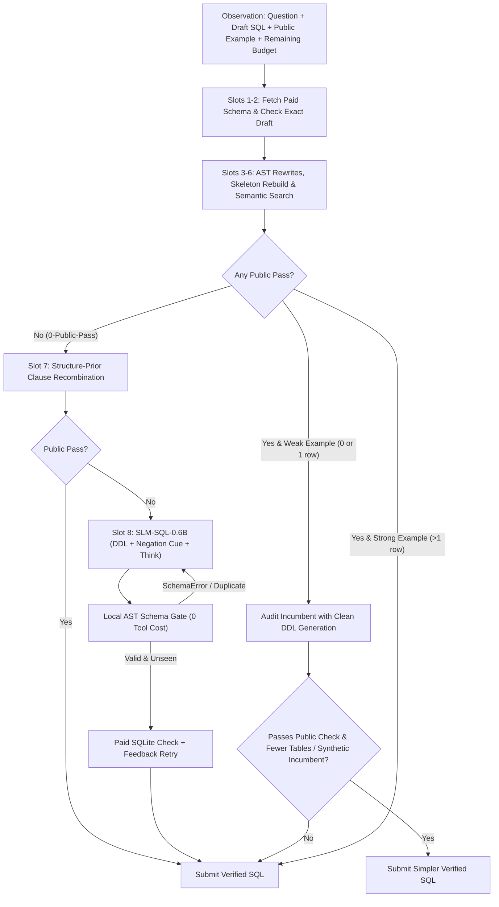

<div align="center">

# SQL Repair Agent: Structure-Aware Search & Schema-Verified Reasoning

[-81.25%25%20(195%2F240)-2ea44f?style=for-the-badge)](outputs/test-score.json)
[-0969da?style=for-the-badge)](report.md)
[-8250df?style=for-the-badge)](https://huggingface.co/cycloneboy/SLM-SQL-0.6B)
[](REPRODUCE.md)
[](requirements.txt)

**An autonomous tool-augmented SQLite repair agent achieving `81.25% (195/240)` exact 3-instance execution accuracy on the DASE7506 Spider-derived SQL Repair benchmark — fully reproducible offline on a 4-thread CPU in 78 minutes with 2.38 GiB peak RAM.**

[Technical Report (EN)](report.md) · [Reproduction Guide](REPRODUCE.md) · [Official Test Score](outputs/test-score.json)

</div>

---

## Highlights

- **Hybrid Perceive-Plan-Act Architecture**: Combines deterministic AST rewrite search, query skeleton reconstruction, and training-calibrated clause recombination (`mp3_agent/` + `compiler.py`) with an offline 0.6B reasoning model (`cycloneboy/SLM-SQL-0.6B`).
- **Zero-Cost Local AST Schema Gate (`schema_check.py`)**: Validates every LLM-generated SQL against the paid database `schema` (tables, column qualifiers, CTEs, and `SELECT` aliases) *before* spending any charged `check` tool call, feeding `SchemaError` diagnostics back for free local retries.
- **Slot-Preserving Budget Scheduler (`submission.py`)**: Protects high-precision offline search on tool Slots 1–6, allocates Slot 7 to structure-prior recombination, and triggers schema-verified LLM reasoning on Slot 8 with real SQLite execution feedback.
- **Weak-Example Table-Count Audit**: Eliminates false positives on empty (`row_count = 0`) and single-row (`row_count = 1`) public examples by auditing incumbents against clean from-scratch DDL generations and replacing redundant-join queries only under training-calibrated precision rules (`+5 / -0` on Train empty examples, `+3 / -0` across 94 Train single-row multi-table tasks).
- **Native CPU `bfloat16` Reproducibility**: Runs strictly offline (`local_files_only=True`, `trust_remote_code=False`, `use_safetensors=True`) in native `torch.bfloat16`, halving memory footprint (`2.38 GiB` Peak RSS) and doubling CPU throughput compared to `float32`.

---

## Architecture Overview



---

## Benchmark Progression & Controlled Ablations

All learned priors (`structure_prior.json`) and audit thresholds were calibrated exclusively on the official **Train** split (480 tasks), validated on **Validation** (120 tasks), and evaluated end-to-end across **all 3 grading database instances** per task on **Test** (240 tasks).

| Stage / System | Validation (120) | Test (240) | Test Net vs Offline |
|---|---:|---:|---:|
| Starter Draft (`issue_sql`, 0 tools) | 47 / 120 (39.17%) | — | — |
| Hint Early-Stop Baseline | 73 / 120 (60.83%) | — | — |
| Offline AST Rewrite Search | 95 / 120 (79.17%) | 175 / 240 (72.92%) | -12 |
| + Skeleton Reconstruction & Semantic Search | 101 / 120 (84.17%) | 183 / 240 (76.25%) | -4 |
| + Structure-Prior Recombination *(Offline Baseline)* | **103 / 120 (85.83%)** | **187 / 240 (77.92%)** | — |
| + Live `SLM-SQL-0.6B` + Initial Empty-Example Audit | 104 / 120 (86.67%) | 190 / 240 (79.17%) | **+3** (+8 / -5) |
| + Local AST Schema Gate + Slot-Preserving Schedule | 107 / 120 (89.17%) | 194 / 240 (80.83%) | **+7** (+9 / -2) |
| **Final Agent (CPU 4-Thread `bfloat16` Verified)** | **108 / 120 (90.00%)** | **195 / 240 (81.25%)** | **+8** (+10 / -2) |

---

## Standalone CPU Reproduction & Compliance Metrics

Measured directly from this standalone directory using `mp3_sql.predict --workers 1` and `mp3_sql.score --workers 4` on a 4-thread CPU (`OMP_NUM_THREADS=4`, `torch.bfloat16`):

| Metric | Measured Value | Official Budget / Limit |
|---|---:|---:|
| **Official Test Accuracy (3-Instance)** | **195 / 240 (81.25%)** | — |
| **Prediction Wall Time** | **4,701.43 s (78.4 min)** | $\le 7,200$ s (2 hours) |
| **Scoring Wall Time** | **81.35 s** | $\le 180$ s |
| **Peak Resident Memory (Peak RSS)** | **2,434.88 MiB (2.38 GiB)** | $\le 16$ GiB |
| **Mean / Max Charged Tool Calls** | **5.9750 / 8** | $\le 8$ |
| **LLM Calls / Max Completions per Task** | **124 calls (95 tasks) / 4** | $\le 6$ per task |
| **Max New Tokens per Completion** | **739** | $\le 2,048$ |
| **Source + Config Footprint (excl. outputs)** | **0.43 MiB** | $\le 16$ MiB |

---

## Repository Layout

```text
submission/
├── submission.py            # Agent entry point (`create_agent`) & slot-preserving controller
├── llm_engine.py            # Offline SLM-SQL-0.6B engine, DDL formatter & retry loop
├── schema_check.py          # Zero-cost local SQLGlot AST schema-binding validator
├── compiler.py              # Structure-prior query recombination engine
├── pattern.py               # Logistic structure prior inference
├── structure_prior.json     # Static weights fitted strictly on official Train split
├── config.json              # Minimal runtime configuration
├── mp3_agent/               # Offline AST rewrite, skeleton & semantic search package
│   └── semantic_catalog.json# Desensitized pure-AST rewrite specifications
├── outputs/
│   ├── test.json            # Full 240-task official test predictions & tool traces
│   ├── test-score.json      # Official 3-instance evaluation score (195/240 = 81.25%)
│   └── generations.jsonl    # Complete offline LLM generation audit log
├── requirements.txt         # Pinned dependencies
├── REPRODUCE.md             # Step-by-step offline reproduction instructions
├── report.md                # Full technical report (English)
└── report_zh.md             # Full technical report (Chinese)
```

---

## Quick Start

1. **Install dependencies** and provision [`cycloneboy/SLM-SQL-0.6B`](https://huggingface.co/cycloneboy/SLM-SQL-0.6B) at revision `88f5b943278482ac9bc7a1ac631c926266f541f` (596,049,920 deduplicated parameters):

```bash
python3 -m venv .venv && source .venv/bin/activate
python -m pip install -r submission/requirements.txt

huggingface-cli download cycloneboy/SLM-SQL-0.6B \
  --revision 88f5b943278482ac9bc7a1ac631c926266f541f \
  --local-dir ./models/SLM-SQL-0.6B
```

2. **Run offline prediction & 3-instance scoring** from the official benchmark root (see [REPRODUCE.md](REPRODUCE.md)):

```bash
export PYTHONPATH="$PWD/submission"
export PYTHONDONTWRITEBYTECODE=1 OMP_NUM_THREADS=4 HF_HUB_OFFLINE=1 TRANSFORMERS_OFFLINE=1
export MP3_BASE_MODEL="$PWD/models/SLM-SQL-0.6B" MP3_DEVICE=cpu MP3_GENERATION_LOG="$PWD/outputs/generations.jsonl"

mkdir -p outputs
python -B -m mp3_sql.predict --split test --method submission/submission.py --checkpoint submission/config.json --workers 1 --output outputs/test.json
python -B -m mp3_sql.score --split test --predictions outputs/test.json --workers 4 --output outputs/test-score.json
```

---

## Attribution & Integrity

- **Benchmark**: Spider-derived DASE7506 SQL Repair benchmark (CC BY-SA 4.0).
- **Base Model**: `cycloneboy/SLM-SQL-0.6B` (`88f5b943278482ac9bc7a1ac631c926266f541f`, `Qwen3ForCausalLM`, 596,049,920 deduplicated parameters; no weights are redistributed in this repository).
- **Safety & Compliance**: All inputs (questions, schemas, hints, DB feedback) are untrusted; every query is gated by read-only AST validation (`validate_sql`) and schema-binding verification (`schema_check.py`), and executed exclusively via the official read-only SQLite executor.
